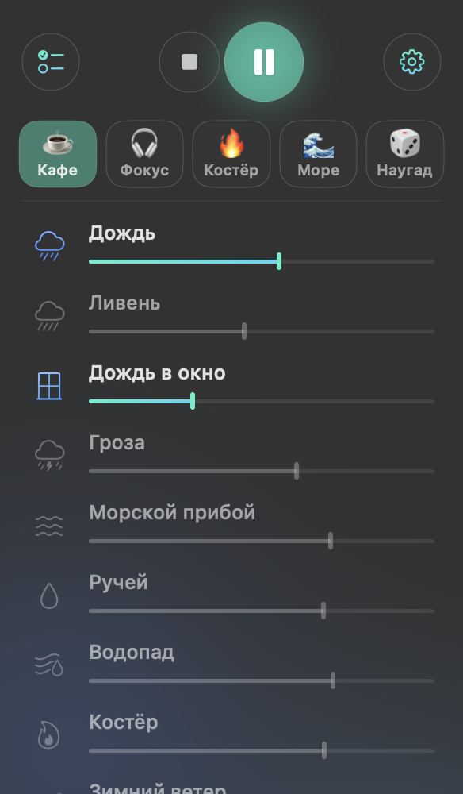

# Murmur

Nature sounds for focus and sleep, right in the macOS menu bar. Mix rain, a campfire, ocean waves, a café, whales, noises and tones — each at its own volume — and keep them playing in the background while you work.



## Features

- **21 sounds, no duplicates**: rain, thunderstorm, ocean waves, stream, underwater, campfire, wind, birds, crickets, whales, street, café, train, library, keyboard, clock, heartbeat, purring cat, vinyl record, singing bowl, white noise.
- **No noticeable repeats.** Recordings never spin as a loop: a granular engine keeps building the sound from random fragments of each recording with random length, speed, pitch and stereo position. Whales are three layers (the song, a distant pod, the ocean), every strike of the singing bowl sounds like a different bowl, the heartbeat has a living rhythm variability, white noise is synthesized in real time.
- **Even loudness**: all recordings are loudness-matched, and a master limiter keeps the mix from clipping.
- **Presets**: Café, Focus, Campfire, Sea, 🎲 Shuffle — one click away; you can save your own mixes.
- **Pomodoro timer**: 15–45 minutes of focus to your mix, breaks in silence, a singing-bowl strike marks each phase change. Global pause **⌃⌥P**, launch at login.
- **Liquid Glass** on macOS 26+: the panel sits on system glass; the theme (system/light/dark), the backdrop (system glass or tinted with the mix's colors) and the accent color (system or one of 11 options) are configurable; the menu bar icon gently "breathes" while sound is playing.
- The UI is in English, or in Russian when Russian is the Mac's first language.
- A native SwiftUI + AVAudioEngine app; the only dependency is Sparkle, which updates the DMG version. Apple Silicon and Intel, macOS 14+.

## Installation

Download `Murmur.dmg` from [Releases](../../releases) and drag Murmur to Applications.

Or with Homebrew:

```bash
brew install --cask docomoz/tap/murmur
```

The app is signed ad-hoc (no Apple Developer certificate), so on first launch macOS asks for confirmation: System Settings → Privacy & Security → Open Anyway. Or:

```bash
xattr -dr com.apple.quarantine /Applications/Murmur.app
```

A waveform icon appears in the menu bar. If you can't see it (for example, it's hidden behind the notch), launching Murmur again opens the mixer as a regular window.

## Building from source

Requires Xcode (the App Intents metadata step uses its tools):

```bash
./build.sh            # → build/Murmur.app and build/Murmur.dmg
```

The first build fetches [Sparkle](https://sparkle-project.org) through SwiftPM — it updates the DMG version.

Debugging: `build/Murmur.app/Contents/MacOS/Murmur --selftest` (levels and repetition of every sound), `--playtest`, `--snapshot <prefix>`.

Project layout, architecture and gotchas are in [HANDOFF.md](HANDOFF.md).

## Sounds and licenses

Recordings come from the open [Moodist](https://github.com/remvze/moodist) library (Pixabay Content License and CC0); details in [CREDITS.md](CREDITS.md). White noise and the heartbeat are synthesized by the app.

The code is MIT-licensed, see [LICENSE](LICENSE). The recordings are covered by their own licenses. Self-update is [Sparkle](https://github.com/sparkle-project/Sparkle) (MIT).
